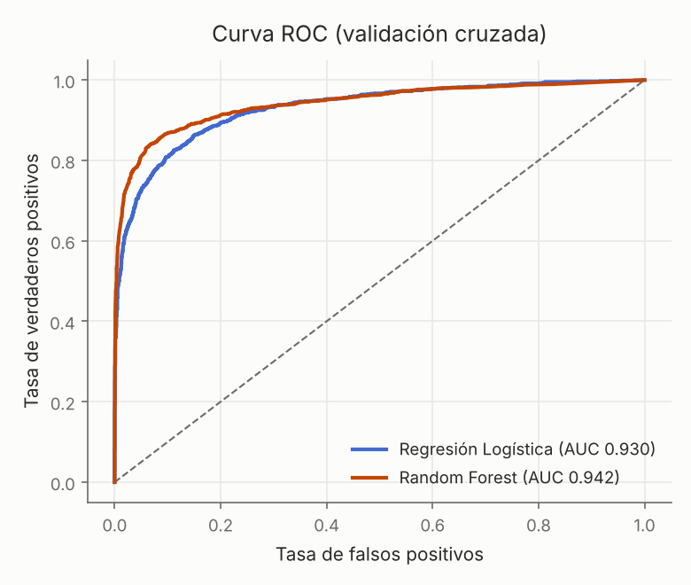
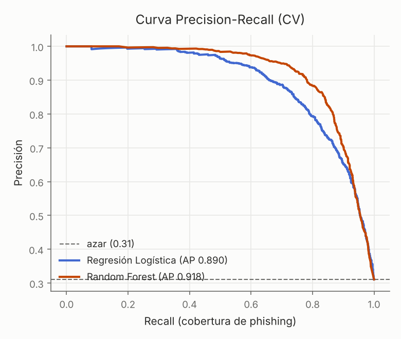

# Calibración de umbral — Random Forest (CV)

Punto de operación según el costo relativo de FP vs FN.

| umbral | precisión | recall | F1 |
|---|---|---|---|
| 0.2 | 0.631 | 0.925 | 0.750 |
| 0.3 | 0.702 | 0.901 | 0.789 |
| 0.4 | 0.767 | 0.876 | 0.818 |
| 0.5 | 0.829 | 0.847 | 0.838 |
| 0.6 | 0.882 | 0.805 | 0.842 |
| 0.7 | 0.936 | 0.733 | 0.822 |
| 0.8 | 0.960 | 0.654 | 0.778 |

**Umbral F1-óptimo ≈ 0.6** (F1 0.842).

- Subí el umbral si el costo de molestar a un usuario legítimo (FP) es alto.
- Bajalo si dejar pasar phishing (FN) es lo más caro — típico en seguridad.

