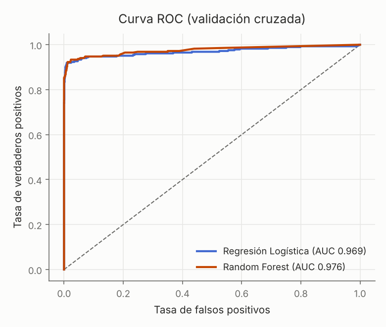
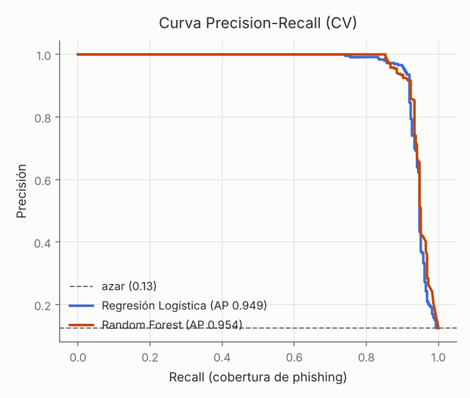

# Calibración de umbral — Random Forest (CV)

Punto de operación según el costo relativo de FP vs FN.

| umbral | precisión | recall | F1 |
|---|---|---|---|
| 0.2 | 0.746 | 0.934 | 0.829 |
| 0.3 | 0.848 | 0.934 | 0.889 |
| 0.4 | 0.916 | 0.920 | 0.918 |
| 0.5 | 0.941 | 0.885 | 0.912 |
| 0.6 | 0.961 | 0.867 | 0.912 |
| 0.7 | 0.980 | 0.857 | 0.914 |
| 0.8 | 1.000 | 0.846 | 0.917 |

**Umbral F1-óptimo ≈ 0.4** (F1 0.918).

- Subí el umbral si el costo de molestar a un usuario legítimo (FP) es alto.
- Bajalo si dejar pasar phishing (FN) es lo más caro — típico en seguridad.

