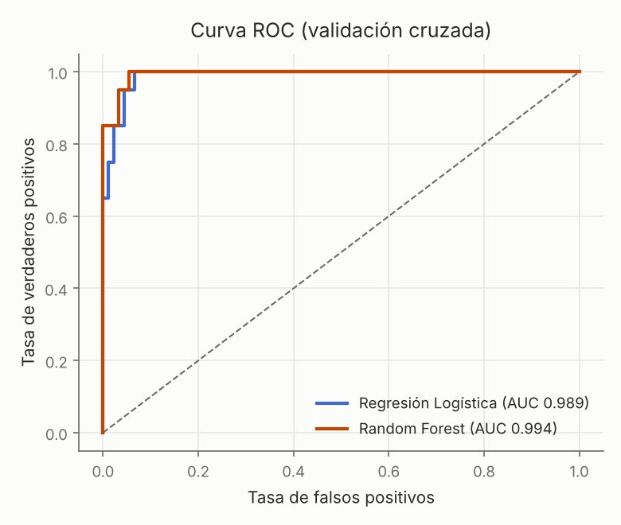
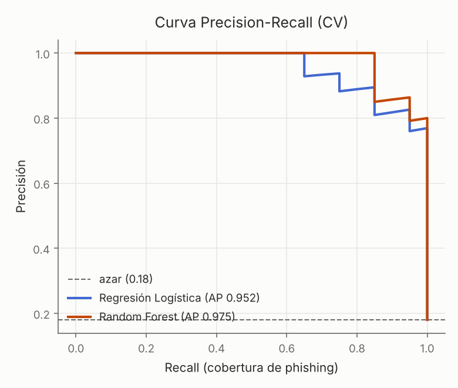

# Calibración de umbral — Random Forest (CV)

Punto de operación según el costo relativo de FP vs FN.

| umbral | precisión | recall | F1 |
|---|---|---|---|
| 0.2 | 0.606 | 1.000 | 0.755 |
| 0.3 | 0.741 | 1.000 | 0.851 |
| 0.4 | 0.792 | 0.950 | 0.864 |
| 0.5 | 0.864 | 0.950 | 0.905 |
| 0.6 | 0.850 | 0.850 | 0.850 |
| 0.7 | 1.000 | 0.850 | 0.919 |
| 0.8 | 1.000 | 0.700 | 0.824 |

**Umbral F1-óptimo ≈ 0.7** (F1 0.919).

- Subí el umbral si el costo de molestar a un usuario legítimo (FP) es alto.
- Bajalo si dejar pasar phishing (FN) es lo más caro — típico en seguridad.

